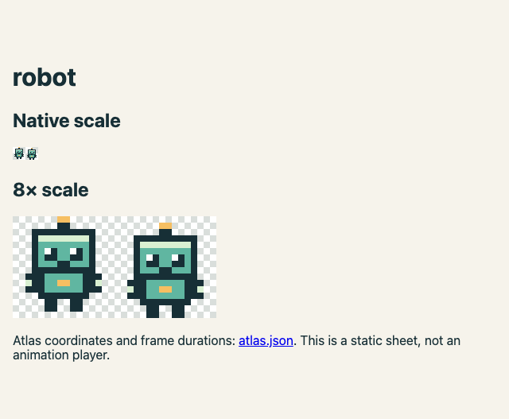

# visual-core

**Good-looking web UI and 2D assets, from a short request to your coding agent.**

Opinionated defaults, small editable sources, and recipes an agent can execute.
The default is a calm warm-paper/teal interface, a compact pixel palette, native
HTML controls, and no framework or model requirement. Existing projects keep their
own design system and engine.

Tell your agent:

> Read https://github.com/KakkoiDev/visual-core and make a polished interface and
> a matching little robot for my app. Show me the result, then revise it with me.

Agents start at [AGENTS.md](AGENTS.md); people start at [using it in a project](docs/project-integration.md).

## Try it

Python 3.11+ for the tools. A browser for previews. No pip/npm install, external
fonts, paid service, model download, MCP server or runtime dependency.

```sh
git clone https://github.com/KakkoiDev/visual-core.git
cd visual-core
python3 tools/visual.py catalog
python3 tools/visual.py init web-app --out ../my-app
python3 tools/visual.py template robot > robot.json
python3 tools/visual.py create robot.json --out ../my-app/assets/robot
python3 -m http.server 8080 --directory ../my-app
```

Open `http://localhost:8080` for the working project board and
`http://localhost:8080/assets/robot/0001/preview.html` for the sprite sheet.
Change real content and actions to fit the app; this is a starter, not a finished
product. After evaluating a revision, pin that Git commit before reusing it.

## Preview

The starter after creating two demonstration projects through its real controls:


Original robot frames, shown at native and 8× scale:



## What works today

| Need | Default | Start here |
|---|---|---|
| Web app / existing UI | Native HTML, scoped CSS, 44 px controls, responsive layout | [Web UI](recipes/web-ui.md) |
| Small SVG icons | Seven consistent original outline shapes | [Icons](recipes/icons.md) |
| Sprites and animation frames | 16×16, limited palette, stable frame IDs; PNG/SVG atlas | [Pixel art](recipes/pixel-art.md) |
| Terrain tiles | Three 16×16 terrain starters; shared renderer | [Tiles](recipes/tiles.md) |
| Game HUD and menus | Adapt existing engine/DOM; no new game engine | [Game UI](recipes/game-ui.md) |
| SVG illustrations | Composition recipe; hand-edited SVG, no scene generator | [Illustration](recipes/illustration.md) |
| Conversational changes | Patch frame IDs or icon/style fields; keep old revisions | [Revise](recipes/revise.md) |

The tool renders deterministic assets. It does not turn natural language into art
by itself: the host agent follows the recipes and edits their constrained sources.
Animation export is a sheet plus timing metadata, not GIF/video. There is no PNG
rasterizer for SVG icons, Aseprite integration, generative model, full game engine,
or automatic accessibility certification. See [scope and limits](docs/scope.md).

## For agents and core maintainers

- [Recipe router](RECIPES.md) and [machine-readable capabilities](CAPABILITIES.json).
- [Design defaults](docs/design-system.md), [composition patterns](docs/composition-patterns.md), [visual verification](recipes/verify.md).
- [Consumer/example registry](IMPLEMENTATIONS.toml): no app is claimed as a consumer yet.
- [Common core-repository standard](docs/core-repo-standard.md) and [reusable scaffold](templates/core/README.md).
- [Research and ownership decisions](docs/research.md): jp-core, jpanki, p2p-core,
  pi-local-harness, and KakkoiSchool/ai-handbook. music-core was empty when inspected.

```sh
python3 tools/validate.py
python3 -m unittest discover -s tests
```

Browser smoke tests are optional development tooling: see [tests/README.md](tests/README.md).
Passing structural tests means the files work, not that an agent has inspected their
appearance. Asset manifests explicitly say `visual_review: not-performed`.
