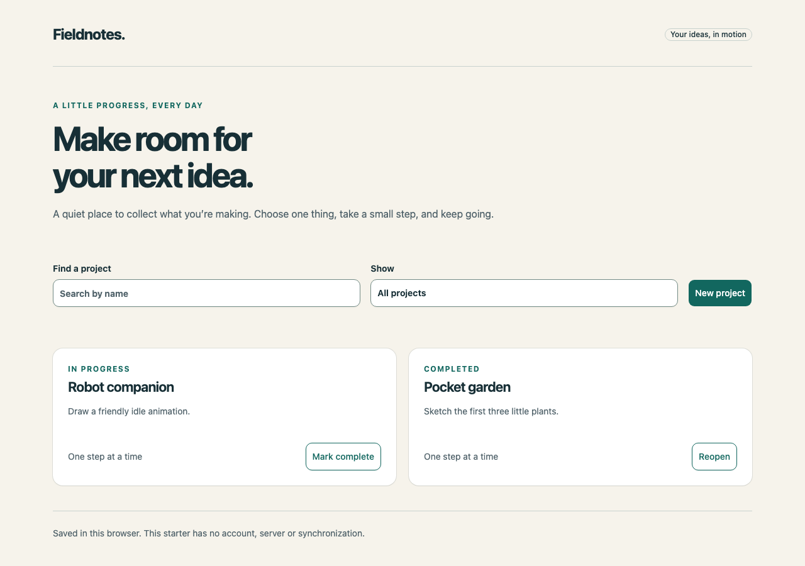
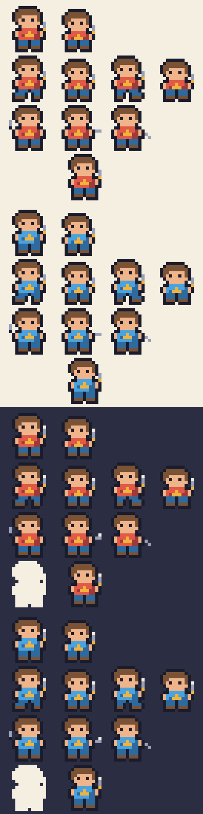
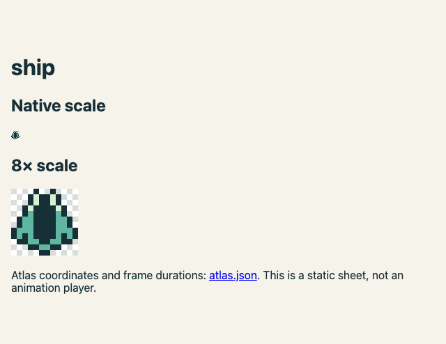

# visual-core

**A local, version-locked visual toolbox for coding agents.**

Use proven components and generators instead of asking a small model to invent
UI widgets or draw every pixel. Clone once; tools, recipes, upstream references,
licenses and working examples are in the repository. Routine use needs no CDN,
package installation, art application, image model or MCP server.

Tell your agent:

> Read this visual-core checkout's AGENTS.md. Use its bundled Basecoat components
> to make my app interface and its seeded pixel tool for a matching retro sprite.
> Use local tools, show the result, and preserve my edits when I ask for changes.

[Agent entry](AGENTS.md) · [Toolbox and version pins](docs/toolbox.md) ·
[Use in a project](docs/project-integration.md) · [Roadmap](TODO.md)

## What is bundled

| Need | Proven tool / default | Local recipe |
|---|---|---|
| Web UI | **Basecoat UI 1.0.2**: prebuilt CSS/JS, full package, component docs and template macros | [Basecoat](recipes/basecoat.md) |
| Copyable component patterns | Working form, tabs, dialog, feedback and disclosure | [Component kit](recipes/basecoat.md) |
| Seeded retro sprites | **Pixel Sprite Generator 0.0.2**, pinned commit; ship/robot/creature presets | [Procedural pixels](recipes/procedural-pixels.md) |
| Consistent SVG icons | **Lucide static 1.59.0**, 50 curated shapes | [Icons](recipes/icons.md) |
| Game sprites from named parts | Deterministic pixel recipes: four palettes, characters, monsters, items, icons, tiles, 9-slice frames, animation rows | [Pixel recipes](recipes/pixel-recipes.md) |
| Exact pixels, frames and terrain | Bounded JSON source, curated robot/terrain presets and PNG/SVG atlas exports | [Pixel edits](recipes/pixel-art.md), [tiles](recipes/tiles.md) |
| Follow-up requests | Stable frame IDs, palette patches and numbered history | [Revisions](recipes/revise.md) |

[Vendor lock](vendor/LOCK.json) records exact versions, upstream commits/archive
integrity and every bundled file's SHA-256. [Notices](THIRD_PARTY_NOTICES.md) retain
original licenses, including Tailwind 4.3.1 already compiled into Basecoat's CSS.
Original adapters are small; the upstream tools do the component/generation work.

## Run locally

Prerequisites: Python 3.11+, Node.js 18+ for procedural sprites and terrain, and a modern browser
for previews. The coding agent/model and these system runtimes are not bundled.
No pip/npm install or frontend build is required for the commands below.

```sh
git clone https://github.com/KakkoiDev/visual-core.git
cd visual-core
python3 tools/vendor.py check
python3 tools/visual.py init web-app --out ../my-app
python3 tools/visual.py generate ship --seed 42 --out ../my-app/assets/ship
python3 -m http.server 8080 --directory ../my-app
```

Open localhost:8080 for the real project board; open
localhost:8080/assets/ship/0001/preview.html for the generated sprite and editable
source. For other UI components, run `init component-kit --out ../component-reference`
and serve that folder. Read only the relevant local recipe and upstream component
file; there is no need to browse for documentation for another version.

## Preview

The Basecoat starter after creating two demonstration projects through its controls:



[The copyable component kit](docs/images/components.png) includes working forms,
keyboard tabs, dialogs and feedback.

The reference hero from a pixel recipe: idle, walk, attack and hurt rows, base and blue variant, on paper and on the dark panel:



The seeded upstream generator's ship, at native and enlarged scale:



## Deliberate boundaries

The agent assembles proven pieces, wires app behavior and reviews the result.
visual-core does not run an agent or turn arbitrary natural language into images.
The procedural generator makes bounded retro silhouettes, not arbitrary detailed
art. Exact frame edits and tile sources remain available. Sheets are not GIFs or
animation players. [Illustration](recipes/illustration.md), [game UI](recipes/game-ui.md)
and [animation integration](recipes/animation.md) are guided recipes using host tools.
There is no live Pi integration or claimed external consumer. Existing apps keep
their framework, engine and visual language. See [limits](docs/scope.md).

## Verify and reuse

```sh
python3 tools/validate.py
python3 -m unittest discover -s tests -v
```

Tests cover locked upstream files, real generator behavior, decoded output pixels,
stable revisions and failures. [Optional browser checks](tests/README.md) verify
local-only requests, Basecoat behavior and the UI at desktop/mobile sizes. A valid
file is not an aesthetic review; manifests say `visual_review: not-performed`.
[Weak-model trials](evals/README.md) remain separate from these automated checks.

- [Recipe router](RECIPES.md), [capability catalog](CAPABILITIES.json), [composition patterns](docs/composition-patterns.md).
- [Common core-repository standard](docs/core-repo-standard.md) and [reusable scaffold](templates/core/README.md).
- [Research](docs/research.md): jp-core, jpanki, p2p-core, pi-local-harness and ai-handbook.
- [Terrain recipes](recipes/tiles.md): local meadow/coast/dungeon Blob 47 generation,
  previews, exact seam checks and preserved revisions; [design](docs/terrain-generator-spec.md).
- [Terrain dependency kit](docs/terrain-dependencies.md): six pinned local sources,
  prebuilt JavaScript and headless extraction probes for future implementation.
- [Consumer/example registry](IMPLEMENTATIONS.toml), [changelog](CHANGELOG.md), [upgrade process](docs/toolbox.md).

- [All 41 Basecoat component references](docs/basecoat-components.md), organized
  offline demos and copyable markup. Chart is reference-only pending Chart.js.
